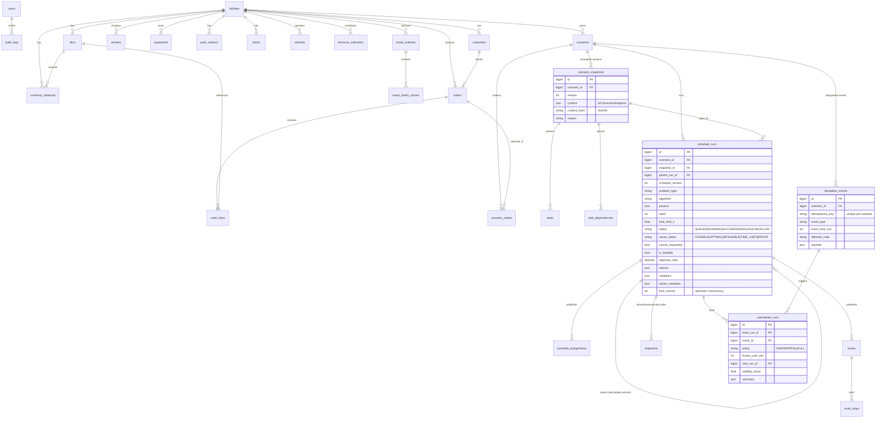

# Entity-relationship diagram (MySQL 8, migrations `0001`, `0002`)

All timestamps are stored as naive UTC `DATETIME` through the `UTCDateTime` type (naive input is rejected).
Durations/distances are integers (minutes / meters / kg / liters); money is `DECIMAL(14,2)`.
Published outputs (`schedule_assignments`, `routes`, `route_stops`, `shipments`, `scenario_snapshots`) are
append-only — an ORM guard raises on UPDATE/DELETE. Foreign keys use `RESTRICT` to preserve history, except
children of a run/snapshot/route (`CASCADE`).

Key indexes: `orders(facility_id, status)`, `orders(due_at)`, `schedule_runs(status, queued_at)`,
`schedule_runs(scenario_id, queued_at)`, `schedule_assignments(run_id, resource_code)`, `routes(run_id, vehicle_code)`,
`disruption_events(scenario_id, event_time_min)`, unique `(facility_id, code)` on every master table,
unique `(scenario_id, version)` on snapshots, unique `(scenario_id, idempotency_key)` on events.
