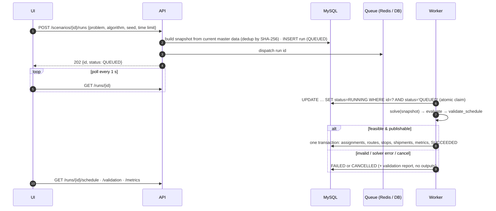
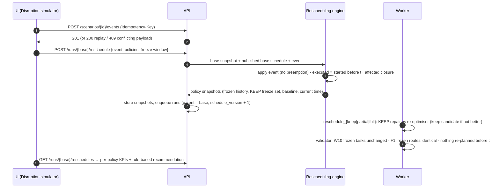

# Architecture

## Components

```mermaid
flowchart LR
  subgraph Browser
    UI[React + TS SPA<br/>TanStack Query · Zustand UI state<br/>SVG Gantt/Dock/Journey · Recharts · Leaflet]
  end
  subgraph Edge
    NG[nginx<br/>static SPA + /api reverse proxy]
  end
  subgraph Backend
    API[FastAPI /api/v1<br/>JWT · typed errors · request IDs]
    W[Worker<br/>Celery (Redis) or DB-poller]
    OPT[Optimization engine<br/>contracts · validator · evaluator<br/>warehouse · dock · routing · integrated · rescheduling]
  end
  DB[(MySQL 8<br/>master data · snapshots · runs · outputs · events · audit)]
  R[(Redis<br/>Celery broker)]

  UI -->|HTTPS JSON| NG --> API
  API -->|enqueue run id| R --> W
  API -->|QUEUED rows| DB
  W -->|claim (atomic UPDATE)| DB
  W --> OPT
  OPT -->|validated result| W -->|publish in one transaction| DB
  API --> DB
```

* The HTTP layer never runs a solver: `POST /scenarios/{id}/runs` stores a QUEUED run and returns **202**.
* `TASK_BACKEND=celery` (compose) transports run IDs via Redis; `db` uses a persistent DB-polling worker
  (`python -m app.tasks.db_worker`); `eager` runs inline for tests. All three call `execute_run(run_id)`.
* The optimization engine is ORM-free: it consumes a `ScenarioSnapshot` and returns a `ScheduleResult`
  (spec §5.1). The shared evaluator computes every KPI/cost term; the independent validator decides publication.

## Run lifecycle



## Disruption handling



## Code map

| Path | Responsibility |
|---|---|
| `backend/app/optimization/common/` | contracts, preprocessing (inventory, explicit unserved), timelines, route timing & repair, evaluator, validator, registry, runner |
| `backend/app/optimization/warehouse/` | serial SGS, FIFO/EDD/SPT, CP-SAT, SA/Tabu/GA |
| `backend/app/optimization/dock/` | dock dispatch + CP-SAT, baseline grouping, dock pipeline |
| `backend/app/optimization/routing/` | units & simulator, NN, cheapest insertion, OR-Tools VRPTW, ALNS |
| `backend/app/optimization/integrated/` | sequential decomposition, iterative coordination |
| `backend/app/optimization/rescheduling/` | events, freeze policies, reschedule algorithms, rolling horizon, recommendation |
| `backend/app/services/` | snapshot builder, scenario store, run lifecycle, rescheduling orchestration, input validation, audit |
| `backend/app/api/v1/` | REST endpoints |
| `frontend/src/features/` | one folder per screen |
